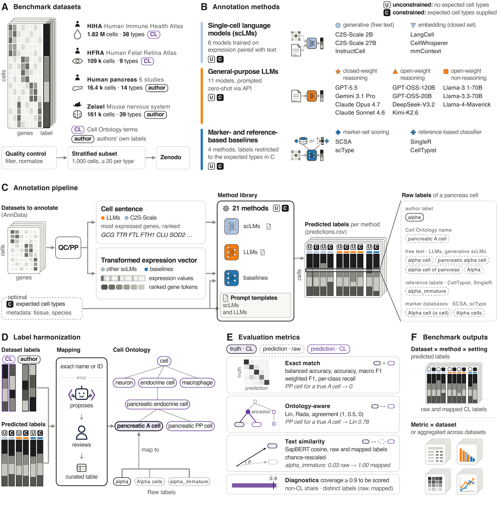

# Cell type annotation benchmark for language models

This repository contains the Nextflow pipeline and the analysis code of our paper *General-purpose
LLMs outperform single-cell language models at cell type annotation when expected types are known*.

The pipeline annotates single-cell RNA-seq data with general-purpose large language models (LLMs),
single-cell language models (scLMs) and established marker- and reference-based methods. scLMs are
language models that were further trained on gene expression data paired with text. All
predictions are mapped to the [Cell Ontology](https://obofoundry.org/ontology/cl.html), which makes
methods with different vocabularies comparable. Every method can run unconstrained or constrained
by a list of the cell types expected in the data.

The pipeline has two modes:

- **Benchmark mode** (`main.nf`) samples test sets from labeled datasets, runs the selected methods
  and scores their predictions against the known labels. The benchmark results of the paper were
  produced in this mode.
- **Annotation mode** (`annotate.nf`) annotates all cells of a dataset and maps the predictions to
  the Cell Ontology without scoring them, for example to label your own data.



*Overview of the benchmark (Figure 1 of the paper).*

## Requirements

- Nextflow 25.04 or later (tested with 25.04.6) and Java 17 or later
- Conda or Mamba (profile `local`), or Docker or Apptainer (profiles `docker` and `apptainer`).
  The pipeline creates one environment per step from the recipes in `envs/`.
- A CUDA GPU for the scLMs
- An [OpenRouter](https://openrouter.ai/) API key for the LLMs

> [!NOTE]
> On macOS, conda cannot build the environments of the two R-based methods, SingleR and scType. The
> install script of Bioconductor's GenomeInfoDbData package expects Linux file names, and SingleR
> 2.8.0 has no build for Apple silicon. Using the Intel packages instead does not help. Run these
> two methods with a container profile.

## Quick start

The repository includes a toy dataset with 40 cells of four cell types. This command builds a test
set from it, annotates the cells with the random baseline and scores the result:

```bash
nextflow run main.nf -profile local -params-file tests/toy.params.yml
```

The results are written to `results_toy/` (see [Outputs](#outputs)). The first run takes a while
because the conda environments are created.

## Benchmark mode

Test sets are sampled stratified by cell type, with at least 20 cells per type. By default the
pipeline downloads the test sets of the paper (1,000 and 10,000 cells) from
[Zenodo](https://doi.org/10.5281/zenodo.24590958), but it can also rebuild them from the original
data. After annotation, the predictions are mapped to the Cell Ontology (see
[below](#mapping-predictions-to-the-cell-ontology)) and scored against the dataset's labels with
accuracy, balanced accuracy, F1, the ontology-based Lin and Rada similarities and an agreement
score that gives half credit for a closely related coarser or finer cell type. A text similarity of
the labels can be added.

Datasets, methods and test set sizes are chosen in a parameter file:

```yaml
# my_run.yml
datasets: [HIHA, human_pancreas]
models: [celltypist_unconstrained, celltypist_constrained, scsa_unconstrained, scsa_constrained]
subset_sizes: [1000]
```

```bash
nextflow run main.nf -profile local -params-file my_run.yml
```

The methods are the folders in `models/`, the datasets the files in `datasets/`. Without a
parameter file, the pipeline runs the eight established methods on the four datasets of the paper.
Single parameters can also be set on the command line, for example `--subset_strategy random`, but
lists have to go into a parameter file. All parameters are described in
[docs/parameters.md](docs/parameters.md).

Predictions are stored in `<outdir>/predictions/` (or in `--predictions_dir`). When the predictions
of a run already exist, the method is not run again and only mapping and scoring are repeated. To
rerun a method, delete its predictions. If the settings of the data have changed since, for
example the quality control, the pipeline stops and names the predictions that no longer fit. A
run that fails in every attempt is left out; the other runs go on, and the pipeline ends with an
error and a note on how many runs are missing.

### LLMs

The LLMs are queried through [OpenRouter](https://openrouter.ai/). To use them, create an account
there, add credit and create an API key. Every request is billed to that account. Store the key as
a Nextflow secret on the machine that runs the pipeline, so that it never shows up in logs or task
scripts:

```bash
nextflow secrets set OPENROUTER_API_KEY 'sk-or-v1-...'
```

`nextflow secrets list` shows the names of the stored secrets, and `nextflow secrets delete
OPENROUTER_API_KEY` removes the key again. Starting the command with a space keeps the key out of
your shell history (in zsh this needs `setopt HIST_IGNORE_SPACE`). Only the LLM methods need the
key. The models and request settings are defined in
`models/openrouter_LLM_unconstrained/src/openrouter.yml`, which all four LLM methods share. Each
LLM method has its prompt template in its own folder (`models/openrouter_LLM_*/prompt.txt`), and
its `method.yml` points to both files. C2S-Scale's templates are in
`models/c2s_scale_2B_*/prompt.txt`, which the 27B folders link to.

## Annotation mode

Annotation mode labels the cells of your own data. The data go in as an h5ad file with raw counts.
Describe them in a configuration file in `datasets/`, for example `datasets/my_data.yml`:

```yaml
name: my_data
path: /path/to/my_data.h5ad        # absolute, or relative to the repository
# All other keys are optional.
species: "human"                   # human (default) or mouse
tissue: "peripheral blood"         # for the methods that use the tissue
annotation_key: "cell_type"        # column of obs with labels, if the data have any
batch_key: "sample"                # column of obs with the batch, if there are several
expected_cell_types: ["monocyte", "B cell", "T cell", "natural killer cell"]
celltypist_model: "Immune_All_Low.pkl"   # CellTypist's model, by default Immune_All_High.pkl
```

Then choose the methods and run `annotate.nf`:

```yaml
# annotate.yml
datasets: [my_data]
models: [celltypist_unconstrained, celltypist_constrained]
```

```bash
nextflow run annotate.nf -profile local -params-file annotate.yml
```

The pipeline runs quality control and preprocessing, annotates every cell and maps the predictions
to the Cell Ontology. [docs/parameters.md](docs/parameters.md#dataset-datasetsnameyml) describes
every key of the configuration, including the inputs that single methods need. To try the mode
first, run it on the toy dataset with `datasets: [toy]`.

The methods in `models` decide whether the data are annotated unconstrained, constrained or both.
The constrained methods choose only among the cell types in `expected_cell_types`, or, without such
a list, among those in the label column. Cell Ontology names work best, because the established
methods relate their own labels to the list through the ontology. For a dataset with neither a list
nor labels, the constrained methods are left out. The list applies to annotation mode only. In
benchmark mode the expected cell types are always those of the labels.

To annotate a random subsample instead of all cells, set `annotation_subset_size`. Methods with a
limit on the number of cells (`max_subset_size` in their `method.yml`), such as the LLMs with one
request per cell, are skipped when all cells are annotated.

## Mapping predictions to the Cell Ontology

Predictions that already name a Cell Ontology term, by name or ID and regardless of case, are used
as they are. All other predictions are looked up in `resources/cell_type_ontology_mappings.csv`, a
semicolon-separated table with one row per distinct prediction:

| Column | Meaning |
|---|---|
| `reviewed` | `True` once a person has checked the row |
| `origin` | the run that first produced the prediction |
| `predicted_label` | the prediction in lower case |
| `chosen_match` | the Cell Ontology term the prediction stands for, or `cell` if it names no cell type |
| `best_match` | the automatic suggestion |

In benchmark mode, new predictions are added to the table as unreviewed rows with a suggestion, and
the pipeline lists them at the end of the run. Unreviewed predictions count as wrong, and a run
receives no metrics if fewer than 90% of its predictions are ontology terms or reviewed rows. After
reviewing the new rows (set `chosen_match`, then set `reviewed` to `True`), rerun the pipeline with
`-resume`. Only mapping and scoring are repeated. Annotation mode never changes the table and marks
unknown predictions as `unmapped`.

## Outputs

| Path in `outdir` | Content |
|---|---|
| `predictions/<method>/<dataset>/<size>_<strategy>/` | the raw predictions of each run, for the LLMs also the provider, tokens and cost of every request (`usage_<model>.csv`) |
| `annotations/<dataset>/<method>/<size>_<strategy>/` (or `all/`) | for every cell the prediction, its Cell Ontology term and ID and how it was mapped, with a summary in JSON |
| `clusters/<dataset>/` | for LLM annotation at the cluster level, the cluster of every cell, the marker genes of every cluster and the clustering settings |
| `evaluation/<dataset>/` | for every run the metrics (JSON), the scores per true cell type and per pair of true and predicted cell type, and a confusion matrix |
| `benchmark_metrics.csv` | one row per dataset, model and test set size |
| `per_class_scores.csv` | recall and ontology scores per true cell type and run |
| `confusion_pairs.csv` | number of cells per pair of true and predicted cell type and run |
| `plots/` | heatmaps of the methods across datasets and rankings, per metric and test set size |

Downloads, test sets and other intermediate files are kept in `cache/`.

## Methods

| Group | Method folders in `models/` |
|---|---|
| General-purpose LLMs, via OpenRouter | `openrouter_LLM_unconstrained`, `openrouter_LLM_constrained`: Claude Opus 4.7, Claude Sonnet 4.6, DeepSeek V3.2, Gemini 3.1 Pro, GPT-5.5, GPT-OSS 20B and 120B, Kimi K2.6, Llama 3.1 70B, Llama 3.3 70B, Llama 4 Maverick |
| scLMs | `c2s_scale_2B_*`, `c2s_scale_27B_*`, `cellwhisperer_*`, `instructcell_*`, `langcell_*`, `mmcontext_*` |
| Established methods | `celltypist_*`, `scsa_*`, `sctype_*`, `singler_*` |
| Chance reference | `random_stratified` |

Every method has one folder per setting, named with the suffix `_unconstrained` or `_constrained`.
Each folder contains a `method.yml` with the method's name and the inputs it needs.

By default, the LLMs receive the 200 most highly expressed genes of each cell. The number of genes
is set by `top_k_genes` in `models/openrouter_LLM_unconstrained/src/openrouter.yml`. With
`gene_pool: hvg`, the genes are taken from the 5,000 most variable genes of the annotated cells
(`n_hvgs`) instead of all genes. With `exclude_rp_mt_hb: true`, ribosomal, mitochondrial and
hemoglobin genes are left out first.

> [!NOTE]
> In the main benchmark of the paper, the LLMs annotate single cells, like the C2S-Scale models.
> They can also annotate at the cluster level (`openrouter_LLM_percluster_unconstrained` and
> `openrouter_LLM_percluster_constrained`). The pipeline then clusters the cells, and each request
> carries the 25 top marker genes of one cluster, whose answer all cells of the cluster receive.
> This needs far fewer requests for large datasets. The clustering options are described in
> [docs/parameters.md](docs/parameters.md#clustering-step).

The generative scLMs (C2S-Scale, InstructCell) write a cell type name. The embedding-based scLMs
(CellWhisperer, LangCell, mmContext) instead pick the closest of a set of candidate names, which are
all Cell Ontology names in the unconstrained setting and the expected cell types in the constrained
setting. The established methods predict from their own fixed vocabularies. In the constrained
setting they keep only labels at or below one of the expected cell types in the Cell Ontology.

## Datasets

| Name | Tissue | Organism | Source |
|---|---|---|---|
| `HFRA` | fetal retina | human | CELLxGENE Census |
| `HIHA` | peripheral blood | human | CELLxGENE Census |
| `Zeisel` | nervous system | mouse | authors' loom file, converted to h5ad (on Zenodo) |
| `human_pancreas` | pancreas | human | figshare (Luecken et al. 2022) |
| `toy` | peripheral blood, 40 cells | human | a sample of `HIHA`, for testing |

New datasets and methods are added as described in
[docs/adding_datasets.md](docs/adding_datasets.md) and
[docs/adding_methods.md](docs/adding_methods.md), with the toy dataset and the random baseline as
examples.

## Reproducing the paper

The folder `paper/` holds the stored predictions of all benchmark runs, the result tables and the
scripts that produce every figure and table of the paper. [paper/README.md](paper/README.md)
explains how to recompute the results from the stored predictions without running any method again.
The prompt-context ablation and the imperfect-list analysis are described in
[paper/experiments/README.md](paper/experiments/README.md).

## Repository layout

```
main.nf, annotate.nf   entry points of the two modes
nextflow.config        parameters and profiles
workflows/, modules/   workflows, processes and helper functions
bin/                   scripts called by the processes
datasets/              dataset configurations and the Zenodo manifest
models/                one folder per method and setting
envs/                  conda environments and container recipes
resources/             mapping table and Ensembl gene tables
docs/                  parameter reference and how-to guides
tests/                 unit tests (each file runs with python) and the toy dataset
paper/                 data, results and code of the paper
```

## License

The code is released under the MIT license (see `LICENSE`). Third-party material keeps its own
license. This applies to the Cell Ontology (CC BY 4.0), the Ensembl gene tables in
`resources/ensembl/` and the toy dataset (CC BY 4.0, see `tests/data/README.md`). The methods
download their own code, data and weights, which come with their own licenses, for example the
R scripts and marker database of scType (GPL-3.0) and the code of LangCell (MIT).

## Citation

If you use this pipeline, please cite our paper. The reference and a link to it will be added
after publication.
